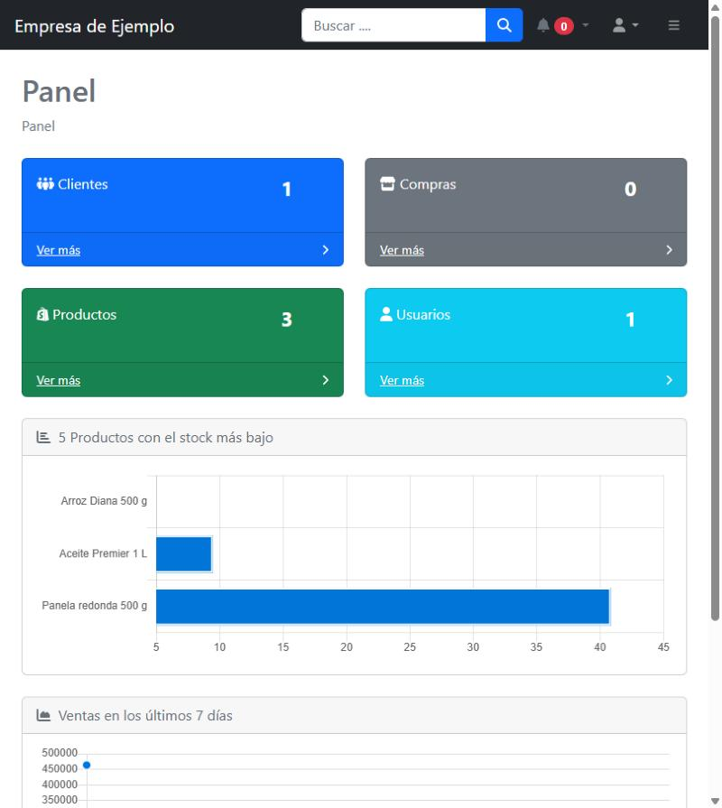
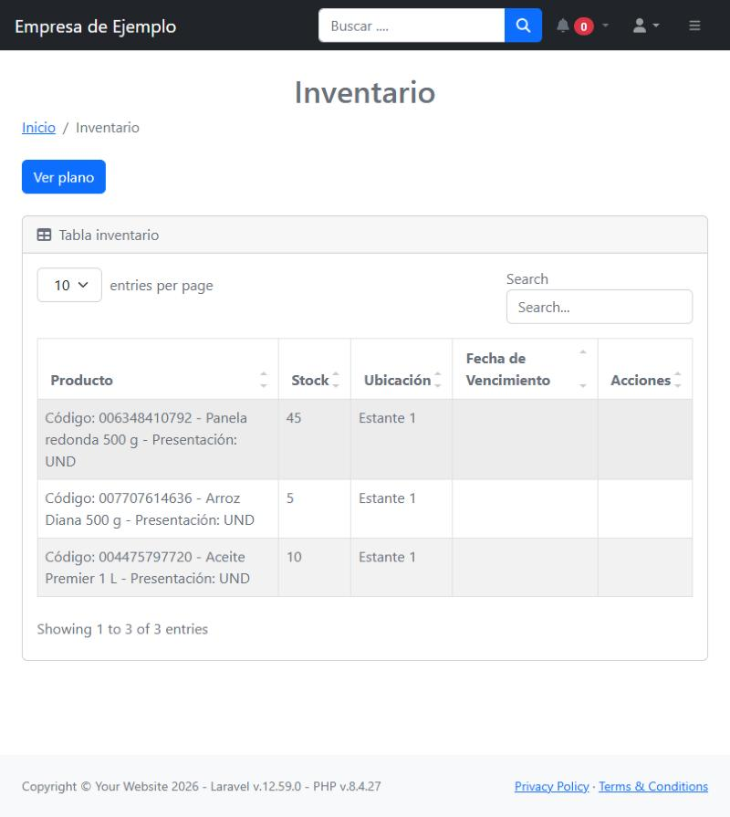
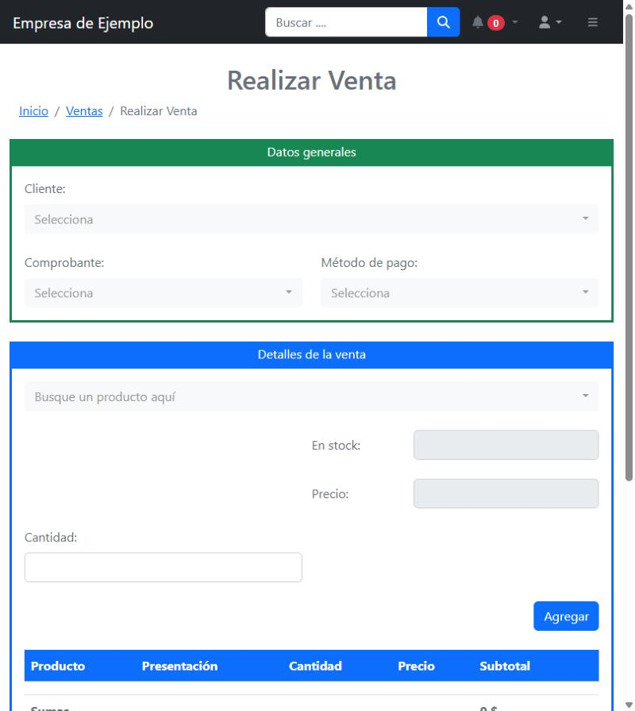
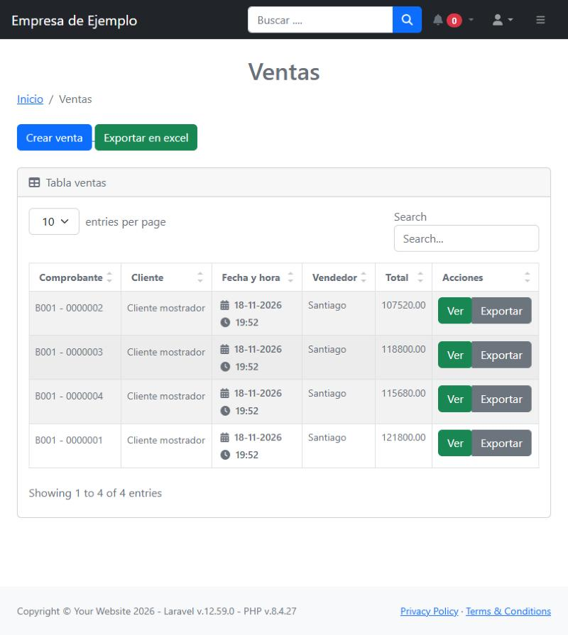
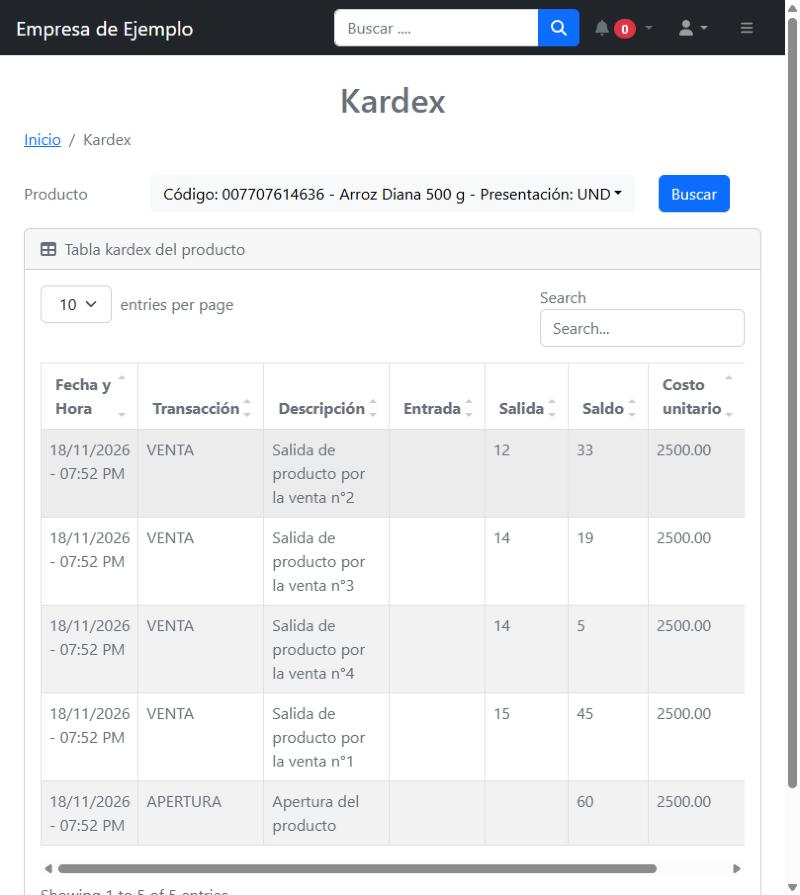
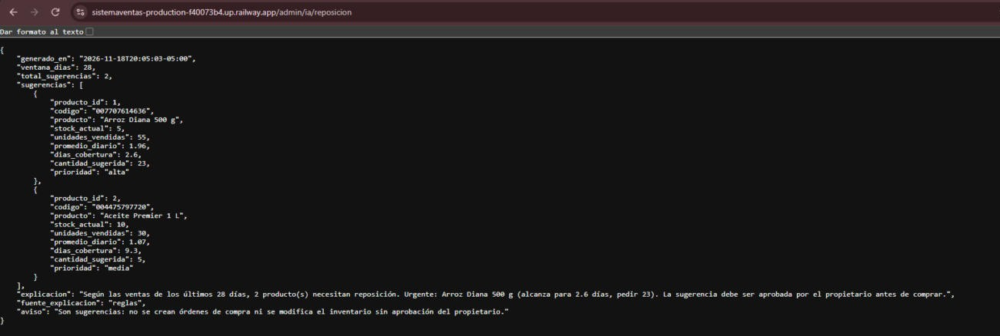

# Manual de usuario – BRYSA, sistema de ventas e inventario

**Aplicación en línea:** https://sistemaventas-production-f40073b4.up.railway.app
**Autores:** Santiago Mejía Londoño y Carol Dahiana González Ceballos

BRYSA reemplaza los cuadernos de la tienda: registra productos, inventario y ventas, y cada venta descuenta el stock, deja el movimiento en el kardex y en la caja. Con el historial de ventas, el sistema sugiere qué productos reponer y cuántas unidades pedir.

## ¿Qué puedes hacer?

| Quiero… | Dónde |
|---|---|
| Entrar al sistema | Pantalla de inicio de sesión |
| Registrar productos y su inventario inicial | Menú **Productos** e **Inventario** |
| Abrir la caja y registrar una venta | Menú **Cajas** y **Ventas → Crear** |
| Ver el stock y el kardex de un producto | Menú **Inventario** y **Kardex** |
| Saber qué reponer y cuánto pedir | **Sugerencia de reposición (IA)** |

> Cada usuario ve solo las opciones que permite su rol. El administrador ve todo.

## 1. Entrar y registrar un producto con su inventario

1. Abre la URL de la aplicación e inicia sesión con tu correo y contraseña.
2. Ve a **Productos → Añadir nuevo registro**, escribe el nombre, la presentación (por ejemplo, unidad o paquete), la categoría y la marca, y pulsa **Guardar**.
3. Ve a **Inventario → Inicializar producto**, elige el producto, la ubicación, la cantidad inicial y el costo unitario, y pulsa **Guardar**. Así queda la apertura del kardex y el precio de venta.

## 2. Abrir la caja y registrar una venta

1. Ve a **Cajas → Aperturar caja** y escribe el saldo inicial. Sin caja abierta no se puede vender.
2. Ve a **Ventas → Crear**. Elige el cliente, el comprobante y el método de pago (efectivo o tarjeta).
3. Busca el producto, escribe la cantidad y pulsa **Agregar**. Repite con cada producto.
4. Escribe el monto recibido; el sistema calcula el vuelto. Pulsa **Realizar venta**.
5. La venta descuenta el inventario, registra la salida en el kardex y el ingreso en la caja, todo en una sola operación. Si falta stock, la venta no se registra.

## 3. Consultar el inventario y el kardex

1. Ve a **Inventario** para ver el stock actual de cada producto.
2. Ve a **Kardex** y elige un producto para ver cada entrada (compras, apertura) y salida (ventas) con su saldo y costo.

## Función de IA: sugerencia de reposición

**Dónde:** `https://sistemaventas-production-f40073b4.up.railway.app/admin/ia/reposicion` (con la sesión iniciada). Desde otro sistema: `GET /api/ia/reposicion` con un token de acceso.

**Qué hace:**

1. Toma las ventas de los últimos 28 días y calcula cuántas unidades vende cada producto por día (promedio móvil).
2. Calcula para cuántos días alcanza el stock actual y cuántas unidades pedir para cubrir 14 días.
3. Marca como **alta** la prioridad de los productos que se agotan en 5 días o menos.
4. Un modelo de lenguaje redacta una explicación corta en español. Si el modelo no está configurado o no responde, el sistema da una explicación calculada por reglas (`"fuente_explicacion": "reglas"`), así que la función nunca deja de responder.

**Cómo leer la respuesta:** `stock_actual` es lo que hay hoy, `promedio_diario` lo que se vende al día, `dias_cobertura` los días que alcanza el stock y `cantidad_sugerida` lo que conviene pedir.

**Límites:**

- Solo **sugiere**: no crea órdenes de compra ni cambia el inventario. La decisión la toma el propietario.
- Necesita historial: un producto sin ventas en la ventana no aparece. Un producto nuevo o de temporada puede quedar mal estimado.
- No conoce promociones, festivos ni precios del proveedor.
- Al modelo de lenguaje solo se le envían nombres de productos y cifras de inventario, **nunca datos de clientes**. La llave del proveedor está en las variables de entorno del servidor, no en el código.

## Problemas frecuentes

| Problema | Qué hacer |
|---|---|
| “Credenciales incorrectas” al entrar | Revisa el correo y la contraseña. Si el usuario está inactivo, pide al administrador que lo active. |
| No me deja registrar la venta | Abre primero una caja en **Cajas → Aperturar caja**. |
| El producto no aparece en la venta | Inicialízalo en **Inventario** y verifica que tenga stock. |
| La venta se rechaza por stock | La cantidad supera las existencias. Registra una compra o baja la cantidad. |
| La sugerencia de IA sale vacía | No hay ventas en los últimos 28 días o ningún producto necesita reposición. Registra ventas o consulta con `?dias=90`. |
| La explicación dice `"fuente_explicacion": "reglas"` | El modelo de lenguaje no está configurado o no respondió; las cifras siguen siendo válidas. |
| No veo un menú | Tu rol no tiene ese permiso. Pide al administrador que lo asigne. |
